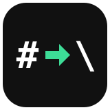
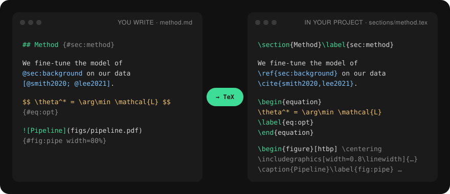
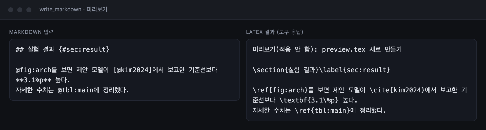
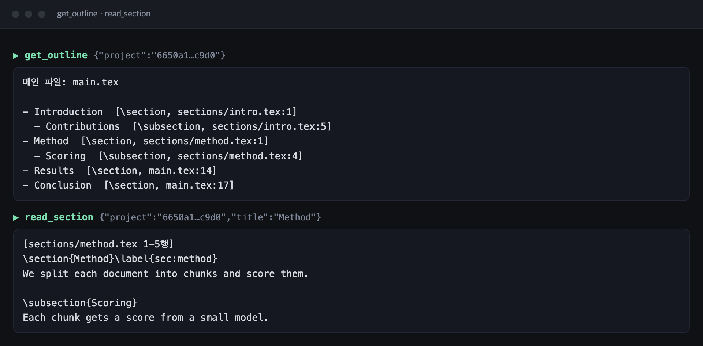
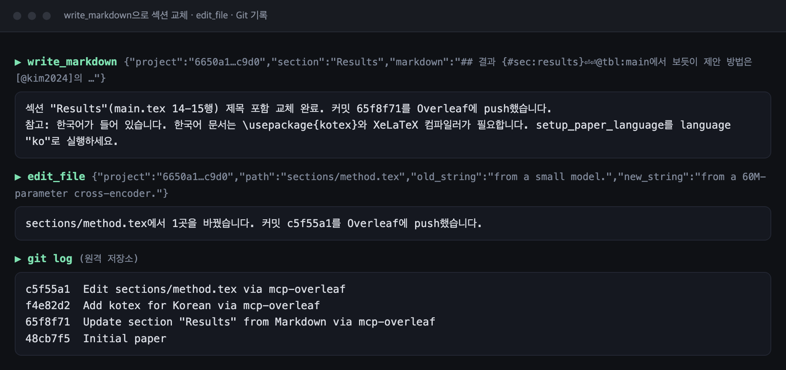
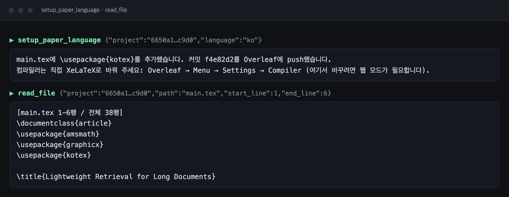

<p align="center">
  
</p>

<h1 align="center">mcp-overleaf</h1>

<p align="center">
  <em>생각은 Markdown으로. 논문은 Overleaf에.</em>
</p>

<p align="center">
  <a href="https://www.npmjs.com/package/mcp-overleaf"></a>
  
  
  
  <a href="LICENSE"></a>
</p>

<p align="center">
  <sub><a href="README.md">English</a> &middot; <strong>한국어</strong></sub>
</p>

<p align="center">
  
</p>

<p align="center">
  <strong>읽고 · 고치고 · 컴파일하고 · 리뷰한다.</strong> AI 에이전트가 LaTeX 프로젝트를 망가뜨리지 않고 앞으로 보냅니다.<br>
  Markdown으로 초안을 쓰면 인용, 상호 참조, 수식, 그림, 표가 제대로 된 LaTeX로 들어갑니다.<br>
  <sub>한국어 논문도 됩니다. 한 번만 호출하면 kotex와 XeLaTeX가 설정됩니다.</sub>
</p>

서론 한 문장을 고치려는데, 에이전트가 프로젝트 전체를 새로 쓰고 프리앰블을 지운 적 있나요?

mcp-overleaf와 함께라면:

```text
“방법 섹션의 마지막 문단을 이 Markdown으로 바꾸고, 컴파일 오류도 확인해 줘.”
```

섹션을 찾아 바꾸고, 필요한 LaTeX를 만들고, Overleaf에 저장합니다. Git으로 쓴 변경에는 커밋도 남습니다.

> [!NOTE]
> **비공식 도구입니다.** mcp-overleaf는 독립 오픈소스 프로젝트이며 Overleaf나 Digital Science와 관련이 없고, 그들의 승인이나 지원을 받지 않습니다. "Overleaf"라는 이름은 이 도구가 무엇과 함께 동작하는지 설명하는 데에만 씁니다. 사용할 때 [Overleaf 이용약관과 이용 정책(Acceptable Use Policy)](https://www.overleaf.com/legal)을 지키는 것은 사용자 책임입니다.

---

## 지금 할 수 있는 일

Claude Code, Claude Desktop, Cursor와 표준 MCP 클라이언트에서 바로 동작합니다. ChatGPT와 Codex에서는 Auth0로 로그인하는 원격 MCP(Streamable HTTP, 실험 기능)로 연결할 수 있습니다.

| 하고 싶은 일 | 도구 |
|---|---|
| Markdown 초안을 LaTeX로 넣기 | `write_markdown` |
| 프로젝트와 파일 살펴보기 | `list_projects`, `list_files`, `read_file`, `get_outline`, `read_section` |
| 파일을 안전하게 고치기 | `edit_file`, `write_file`, `move_file`, `delete_file` |
| 컴파일·PDF·리뷰 댓글 다루기 | `compile`, `download_pdf`, `get_comments`, `add_comment`, `reply_comment`, `resolve_comment` |
| 한국어 논문 준비하기 | `setup_paper_language` |

도구별 설명과 필요한 인증은 [도구](#도구)에 있습니다.

## 빠른 시작

Node.js 20 이상과 git이 필요합니다. Git 토큰은 Overleaf → Account Settings → *Git Integration* → *Generate token*에서 만듭니다.

**Claude Code:**

```bash
claude mcp add overleaf -e OVERLEAF_GIT_TOKEN=olp_... -e OVERLEAF_LANG=ko -- npx -y mcp-overleaf
```

**Claude Desktop / Cursor / 기타:**

```json
{
  "mcpServers": {
    "overleaf": {
      "command": "npx",
      "args": ["-y", "mcp-overleaf"],
      "env": {
        "OVERLEAF_GIT_TOKEN": "olp_...",
        "OVERLEAF_LANG": "ko",
        "OVERLEAF_PROJECT_ID": "선택: 기본 프로젝트 ID"
      }
    }
  }
}
```

그다음엔 그냥 말하면 됩니다.

- *"내 학위논문 목차 보여 줘."*
- *"이 Markdown 초안으로 Method 섹션 다시 써 줘."*
- *"컴파일하고 에러 알려 줘."*
- *"아직 안 끝난 리뷰 댓글에 답 달아 줘."*

Windows에서 클라이언트가 `npx`를 찾지 못하면 `"command": "cmd"`, `"args": ["/c", "npx", "-y", "mcp-overleaf"]`를 쓰세요. 웹 모드를 켜는 방법은 [인증](#인증)을 보세요.

**ChatGPT / Codex (원격 MCP, 실험 기능):**

공개 HTTPS 서버와 Auth0가 필요합니다. 각 사용자는 Auth0로 로그인한 뒤 자신의 Overleaf Git 토큰을 별도의 신뢰할 수 있는 설정 화면에서 등록합니다. 토큰을 채팅에 붙여 넣지 마세요.

```bash
docker build -t mcp-overleaf .
docker run --rm -p 3000:3000 --env-file .env -v mcp-overleaf-data:/data mcp-overleaf
```

ChatGPT에서는 **Plugins → Add custom MCP server**에서 `https://<도메인>/mcp`를 입력하고 OAuth를 선택합니다. Auth0 구성, 환경변수, 토큰 등록 API와 운영상 주의사항은 [원격 MCP + Auth0 가이드](docs/remote-auth0.md)를 보세요.

## 실제 화면

mcp-overleaf 0.1.0을 예제 논문에 실행해서 받은 실제 응답입니다. 스크린샷은 손대지 않았습니다.

<p align="center">
  
  <br><sub><b>Markdown을 넣으면 LaTeX로.</b> 참조 뒤에 붙은 조사도 그대로 둡니다.</sub>
</p>

<p align="center">
  
  <br><sub><b>목차는 <code>\input</code>으로 나뉜 파일까지 따라갑니다.</b> 섹션마다 파일과 줄 번호가 붙습니다.</sub>
</p>

<p align="center">
  
  <br><sub><b>바꿀 때마다 커밋이 남습니다.</b> 한국어 설정이 없으면 먼저 알려 줍니다.</sub>
</p>

<p align="center">
  
  <br><sub><b>한국어 논문 준비는 한 번에.</b> <code>setup_paper_language</code>가 kotex를 넣어 줍니다.</sub>
</p>

## 도구

| | 도구 | 하는 일 | 필요한 것 |
|---|---|---|---|
| ✍️&nbsp;**쓰기** | `write_markdown` | Markdown을 LaTeX로 바꿔 파일에 쓰거나 섹션을 교체 | git 또는 웹¹ (`dry_run`은 필요 없음) |
| | `write_file` | 파일을 만들거나 덮어쓰고 Overleaf에 저장 | git 또는 웹¹ |
| | `edit_file` | 정확한 문자열을 찾아 바꾸고 Overleaf에 저장 | git 또는 웹¹ |
| 📖&nbsp;**읽기** | `list_projects` | 내 프로젝트 목록과 ID | 웹¹ |
| | `list_files` | 프로젝트의 파일 목록 | git 또는 웹¹ |
| | `read_file` | 파일 읽기(줄 범위 지정 가능) | git 또는 웹¹ |
| | `get_outline` | `\input`/`\include`로 연결된 파일까지 포함한 섹션 구조와 파일:줄 위치 | git 또는 웹¹ |
| | `read_section` | 제목으로 섹션 하나의 소스 읽기 | git 또는 웹¹ |
| 🗂️&nbsp;**파일** | `move_file` | 파일·폴더 이름 변경이나 이동(없는 폴더는 만듦) | git 또는 웹¹ |
| | `delete_file` | 파일·폴더 삭제(History에서 복구 가능) | git 또는 웹¹ |
| 🌐&nbsp;**언어** | `setup_paper_language` | 한국어(kotex + XeLaTeX) 또는 영어 논문용으로 프로젝트 준비 | git 또는 웹¹ |
| 🛠️&nbsp;**컴파일** | `compile` | Overleaf에서 컴파일하고 에러·경고를 파일:줄 위치와 함께 보고 | 웹¹ |
| | `download_pdf` | 컴파일해서 PDF를 내 컴퓨터에 저장 | 웹¹ |
| 💬&nbsp;**리뷰** | `get_comments` | 리뷰 댓글 스레드를 댓글이 달린 문장·위치와 함께 보기 | 웹¹ |
| | `add_comment` | 편집기에서 형광펜을 칠하듯 문장에 새 댓글 달기 | 웹¹ |
| | `reply_comment` | 댓글 스레드에 답글 달기 | 웹¹ |
| | `resolve_comment` | 댓글 스레드를 해결 처리하거나 다시 열기 | 웹¹ |

¹ **웹** = 선택 기능인 웹 모드이며 기본으로 꺼져 있습니다. [Overleaf 약관과 웹 모드](#overleaf-약관과-웹-모드)를 꼭 읽어 주세요. Git 토큰만 있어도 읽기, 목차, Markdown 작성, 수정, 이동, 삭제를 쓸 수 있습니다.

프로젝트는 ID나 Overleaf URL로 지정합니다(웹 모드에서는 이름으로도 가능).

## Markdown으로 쓰기

Markdown으로 초안을 쓰거나(AI에게 쓰게 해도 됩니다) `write_markdown`에 넘기면 Overleaf 프로젝트 안에 LaTeX로 들어갑니다.

```markdown
## 방법 {#sec:method}

@sec:background의 모델을 우리 데이터로 미세 조정했다[@smith2020; @lee2021, p. 3].
손실 함수는 $\mathcal{L} = -\sum_i \log p(y_i)$이다.

$$
\theta^* = \arg\min_\theta \mathcal{L}(\theta)
$$ {#eq:opt}

{#fig:pipeline width=80%}

| 모델 | 정확도 |
|:------|-----:|
| 제안 모델 | 91.2 |

Table: 주요 결과 {#tbl:main}
```

이 내용은 `\section{방법}\label{sec:method}`, `\cite{smith2020,lee2021}`, `\label{eq:opt}`가 붙은 `equation`, 캡션과 라벨이 있는 `figure`와 `table`로 바뀝니다.

| Markdown | LaTeX |
|---|---|
| `#`, `##`, … | 가장 얕은 단계 → `\section`(또는 `top_level`), 그다음 `\subsection`, … |
| `## 제목 {#sec:x}` / `{-}` | `\label{sec:x}` / 번호 없는(별표) 제목 |
| `*기울임*`, `**굵게**`, `` `코드` ``, `~~취소선~~` | `\emph`, `\textbf`, `\texttt`, `\sout` |
| `$…$`, `$$…$$ {#eq:x}` | 그대로 / 라벨이 붙은 `equation` |
| `[@a; @b, p. 3]`, `@a` | `\cite[p. 3]{a,b}`, `\cite{a}` |
| `@fig:x`, `@sec:x`, `@eq:x`, `@tbl:x` | `\ref{…}` |
| `{#fig:x width=60%}` | `\includegraphics`, 캡션, 라벨이 있는 `figure` |
| 파이프 표 + `Table: 캡션 {#tbl:x}` | `table` + `tabular` |
| `[^1]` / `^[인라인]` 각주 | `\footnote{…}` |
| 목록, 체크리스트, `>` 인용, 코드 블록 | `itemize`/`enumerate`, `quote`, `verbatim` |
| `\아무명령{…}`, `\begin{env}…\end{env}` | 손대지 않고 그대로 통과 |

어디에 넣을지:

- `path: "sections/method.tex"`: 그 파일을 만들거나 덮어씁니다(메인 파일에서 `\input`으로 불러오세요). 메인 파일은 덮어쓰지 않습니다. 프리앰블이 사라지기 때문입니다.
- `path` + `mode: "append"`: 파일 끝, `\end{document}` 바로 앞에 추가합니다.
- `section: "Method"`: 기존 섹션을 교체합니다. Markdown이 제목으로 시작하면 제목까지 바뀌고, 아니면 본문만 바뀌며 기존 `\label`은 유지됩니다. 제목 단계는 그 섹션을 기준으로 맞춰집니다.
- `md_path`: 텍스트 대신 내 컴퓨터의 `.md` 파일을 읽습니다.
- `dry_run: true`: 아무것도 올리지 않고 변환된 LaTeX만 보여 줍니다.

변환 결과에 필요한 패키지가 프리앰블에 없으면 알려 줍니다(예: 링크에는 `hyperref`, 그림에는 `graphicx`).

## 한국어와 영어

**논문.** 영어 논문은 따로 설정할 필요가 없습니다. 한국어 논문은 처음에 `setup_paper_language`를 `language: "ko"`로 한 번 실행하세요. 메인 파일 프리앰블에 `\usepackage{kotex}`를 넣고(kotex나 xeCJK 같은 한국어 패키지가 이미 있으면 넣지 않음) 컴파일러를 XeLaTeX로 바꿉니다. 컴파일러 변경에는 웹 모드가 필요하며, 웹 모드가 꺼져 있으면 Overleaf에서 직접 바꾸는 방법(Menu → Settings → Compiler)을 알려 줍니다.

이 단계를 기억하지 않아도 됩니다. 한국어 지원이 없는 프로젝트에 한국어를 쓰면 `write_markdown`이 알려 주고, 한글 때문에 컴파일 에러(`Unicode character 한 (U+D55C)`)가 나면 `compile`이 해결 방법을 함께 보여 줍니다. Markdown 변환기는 참조와 인용 바로 뒤에 붙는 조사도 처리합니다. `@fig:arch를`은 `\ref{fig:arch}를`, `[@kim2024]에서`는 `\cite{kim2024}에서`가 됩니다.

**응답 언어.** `OVERLEAF_LANG=ko`로 설정하면 도구 결과, 오류, 경고를 한국어로 돌려줍니다(기본값은 `en`). Overleaf나 git이 보낸 원문 메시지는 그대로 둡니다.

## 인증

**Git 토큰**(`OVERLEAF_GIT_TOKEN`): 기본이자 권장하는 방식입니다. Overleaf 공식 [Git 연동](https://docs.overleaf.com/integrations-and-add-ons/git-integration-and-github-synchronization/git-integration)을 쓰며 실제 커밋이 남습니다. Git 연동은 프로젝트 소유자가 유료 또는 기관 플랜이어야 합니다.
Overleaf → Account Settings → *Git Integration* → *Generate token*.

**웹 모드**(선택, 기본 꺼짐. `OVERLEAF_ENABLE_WEB=1`과 `OVERLEAF_SESSION_COOKIE`를 모두 설정): 프로젝트 목록, 컴파일, PDF, 리뷰 댓글을 쓸 수 있고, 무료 플랜 프로젝트도 읽고 쓸 수 있습니다. **켜기 전에 [Overleaf 약관과 웹 모드](#overleaf-약관과-웹-모드)를 꼭 읽어 주세요.**
쿠키는 overleaf.com에 로그인한 뒤 개발자 도구 → Application(Chrome) / Storage(Firefox) → Cookies → `https://www.overleaf.com`에서 `overleaf_session2`의 값을 복사하면 됩니다. 로그아웃하면 만료됩니다. 쿠키만 넣어서는 아무 일도 일어나지 않으며, `OVERLEAF_ENABLE_WEB=1`도 설정해야 웹 모드가 켜집니다.

켜려면 `env`에 `"OVERLEAF_ENABLE_WEB": "1"`과 `"OVERLEAF_SESSION_COOKIE": "s%3A..."`를 추가하세요. Claude Code에서는 `-e OVERLEAF_ENABLE_WEB=1 -e OVERLEAF_SESSION_COOKIE=...`를 붙이면 됩니다.

> [!CAUTION]
> 두 인증 정보 모두 프로젝트 전체에 접근할 수 있습니다. 비밀번호처럼 다루고 절대 커밋하지 마세요.

## Overleaf 약관과 웹 모드

웹 모드는 Overleaf 웹사이트가 쓰는 것과 같은 **내부** 웹 주소와 실시간 편집 서비스에 접속합니다. 공개 API가 아닙니다. Overleaf [이용 정책(Acceptable Use Policy)](https://www.overleaf.com/legal)(2026년 5월 5일 개정)은 특히 다음을 금지합니다.

- "공개적으로 지원되는 인터페이스(publicly supported interfaces)" 이외의 방법으로 접근하는 것
- 로봇, 스크립트, 스파이더 같은 자동화 수단으로 접근하는 것
- "정상적인 사람의 수동 사용"과 맞지 않는 사용, 서비스를 "외부 시스템의 처리 엔진이나 API"로 쓰는 것
- 리버스 엔지니어링
- 자동 접근으로 얻은 내용을 머신러닝과 관련해 쓰는 것

> [!WARNING]
> 웹 모드는 이 규정에 해당할 가능성이 매우 높습니다. Overleaf는 사용 패턴을 모니터링하며 계정을 정지할 수 있습니다. **웹 모드를 켜면 본인 계정으로, 본인 책임하에 쓰는 것입니다.** 웹 모드가 켜져 있으면 서버가 시작할 때마다 경고를 출력합니다.

Git 방식은 공식 문서가 있는 연동이라 더 안전한 선택입니다. 다만 공정 사용 조항과 머신러닝 조항은 자동화된 사용 전반에 적용될 수 있습니다. 적당히 사용하고, 최신 약관을 직접 확인하세요.

## 전체 설정

| 변수 | 기본값 | |
|---|---|---|
| `OVERLEAF_GIT_TOKEN` | | Git 연동 토큰 |
| `OVERLEAF_ENABLE_WEB` | 꺼짐 | `1`로 설정하면 본인 책임하에 웹 모드를 켭니다 |
| `OVERLEAF_SESSION_COOKIE` | | `overleaf_session2` 값, 또는 다른 Overleaf 서버용 `이름=값` 형태의 쿠키. 웹 모드에서만 사용 |
| `OVERLEAF_PROJECT_ID` | | 도구 호출에 `project`가 없을 때 쓸 기본 프로젝트 |
| `OVERLEAF_LANG` | `en` | 도구 응답 언어: `en` 또는 `ko` |
| `OVERLEAF_BASE_URL` | `https://www.overleaf.com` | 직접 설치한 Overleaf(Community Edition) 주소 |
| `OVERLEAF_GIT_URL` | `https://git.overleaf.com` | Git 브리지 주소. Server Pro는 `https://<사이트>/git` |
| `OVERLEAF_MCP_CACHE_DIR` | `~/.mcp-overleaf` | 프로젝트 사본과 PDF를 저장할 폴더 |
| `OVERLEAF_GIT_AUTHOR_NAME` / `_EMAIL` | `Overleaf MCP` | 커밋 작성자 |
| `MCP_PUBLIC_URL` | | 원격 MCP의 공개 HTTPS origin (`/mcp` 제외) |
| `AUTH0_DOMAIN` / `AUTH0_AUDIENCE` | | 원격 MCP 사용자 인증용 Auth0 설정 |
| `OVERLEAF_CREDENTIALS_KEY` | | 사용자별 Git 토큰 암호화용 base64 32-byte 키 |

## 동작 방식

- **Git 모드**: 프로젝트마다 캐시 폴더에 clone합니다. 읽을 때는 최대 15초에 한 번 pull하고, 수정할 때마다 pull → 커밋 → push를 바로 합니다. 그사이 누가 수정했으면 한 번 rebase합니다. 그래도 push가 실패하면 로컬 사본을 되돌리고 저장되지 않았다고 알려 줍니다. 토큰은 환경 변수 범위의 git 설정으로만 넘기므로 디스크나 프로세스 목록에 남지 않습니다.
- Overleaf는 [Git push가 변경 추적과 댓글을 잃게 하거나 위치를 바꿀 수 있다](https://docs.overleaf.com/integrations-and-add-ons/git-integration-and-github-synchronization/git-integration)고 경고합니다. 리뷰 댓글이 달린 부분은 Git으로 고치지 않는 것이 좋습니다.
- **웹 모드**(선택; Git 접근이 없는 프로젝트에 사용): 쓰기 직전에 항상 프로젝트 zip을 새로 받아 변경을 적용하고, 편집기의 업로드 경로(Overleaf 화면의 "Upload"와 같은 경로, 없는 폴더는 만듦)로 저장합니다. Overleaf가 새 내용을 차이(diff)로 적용하기 때문에 바뀌지 않은 문장의 댓글은 그대로 남습니다(overleaf.com에서 확인). 커밋은 남지 않으니 Overleaf의 History로 확인하거나 되돌리세요. "no git access"라고 응답한 프로젝트는 그 세션 동안 기억해서 Git을 다시 시도하지 않습니다.
- 파일 경로는 프로젝트 안으로 제한됩니다. `..`, 절대 경로, `.git/`은 거부합니다.

## 자주 묻는 질문

**Overleaf 유료 플랜이 필요한가요?**
Git 모드는 프로젝트 소유자가 유료 또는 기관 플랜이어야 합니다. 무료 플랜 프로젝트는 "no git access"라고 응답합니다. 웹 모드는 무료 플랜에서도 되지만, 먼저 [약관 섹션](#overleaf-약관과-웹-모드)을 읽어 주세요.

**공동 작업자의 리뷰 댓글이 망가지지 않나요?**
웹 모드로 저장하면 바뀌지 않은 문장의 댓글은 그대로 남습니다. Git push는 댓글을 잃거나 위치를 바꿀 수 있으니, 댓글이 달린 부분은 Git으로 고치지 마세요.

**변경을 되돌릴 수 있나요?**
Git 모드는 수정할 때마다 실제 커밋을 남깁니다. 웹 모드에서는 Overleaf의 History를 쓰세요.

**직접 설치한 Overleaf에서도 되나요?**
네. `OVERLEAF_BASE_URL`을 설정하고, Server Pro라면 `OVERLEAF_GIT_URL=https://<사이트>/git`도 설정하세요.

**공식 도구인가요?**
아닙니다. Overleaf와 관련 없는 독립 프로젝트입니다.

## 개발

```bash
npm install
npm test
npm run inspect
```

`npm run inspect`는 로컬 빌드로 MCP Inspector를 엽니다.

## 로드맵

- 변경 추적(track changes) 수락·거절
- 이미지 등 바이너리 파일 업로드
- 변경 이력과 비교

기여를 환영합니다.

## 감사의 말

[mjyoo2/OverleafMCP](https://github.com/mjyoo2/OverleafMCP)(MIT)에서 영감을 받았으며, 코드는 처음부터 새로 작성했습니다.

## 라이선스

[MIT](LICENSE).

## Star History

<a href="https://www.star-history.com/#kimhyunji24/mcp-overleaf&Date">
  <picture>
    <source media="(prefers-color-scheme: dark)" srcset="https://api.star-history.com/svg?repos=kimhyunji24/mcp-overleaf&type=Date&theme=dark" />
    <source media="(prefers-color-scheme: light)" srcset="https://api.star-history.com/svg?repos=kimhyunji24/mcp-overleaf&type=Date" />
    
  </picture>
</a>
