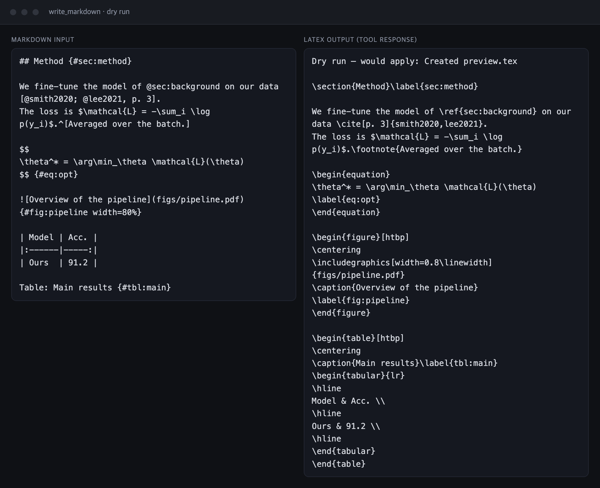
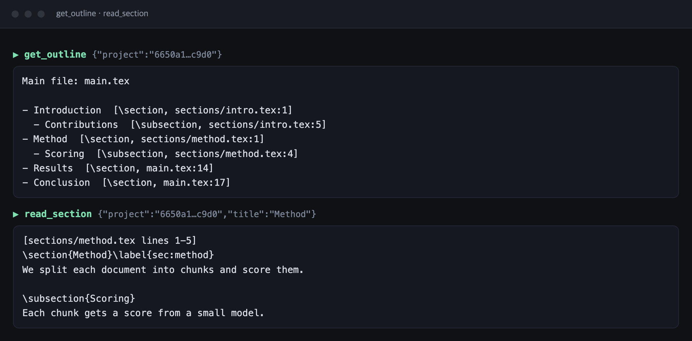
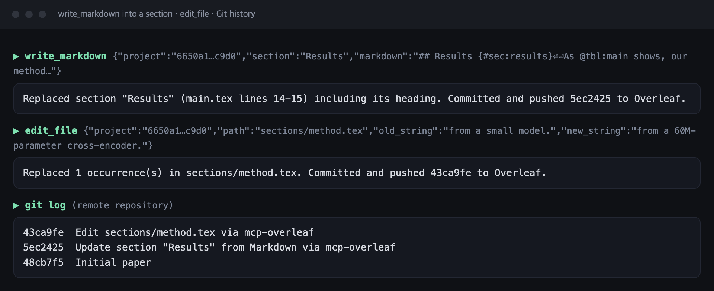

<p align="center">
  
</p>

<h1 align="center">mcp-overleaf</h1>

<p align="center">
  <em>Write in Markdown. It lands in Overleaf as LaTeX.</em>
</p>

<p align="center">
  <a href="https://www.npmjs.com/package/mcp-overleaf"></a>
  
  
  
  <a href="LICENSE"></a>
</p>

<p align="center">
  <sub><strong>English</strong> &middot; <a href="README.ko.md">한국어</a></sub>
</p>

<p align="center">
  
</p>

<p align="center">
  <strong>Read, edit, compile and review your Overleaf projects from Claude, Cursor and other MCP clients.</strong><br>
  Draft in Markdown, and your citations, cross-references, equations, figures and tables arrive as proper LaTeX.<br>
  <sub>Korean papers too: one call sets up kotex and XeLaTeX.</sub>
</p>

> [!NOTE]
> **Unofficial.** mcp-overleaf is an independent open-source project. It is not affiliated with, endorsed by, or supported by Overleaf or Digital Science. "Overleaf" is used only to describe what this tool works with. You are responsible for following [Overleaf's Terms of Service and Acceptable Use Policy](https://www.overleaf.com/legal) when you use it.

---

## Quick start

Requires Node.js 20+ and git. Get a Git token in Overleaf → Account Settings → *Git Integration* → *Generate token*.

**Claude Code:**

```bash
claude mcp add overleaf -e OVERLEAF_GIT_TOKEN=olp_... -- npx -y mcp-overleaf
```

**Claude Desktop / Cursor / others:**

```json
{
  "mcpServers": {
    "overleaf": {
      "command": "npx",
      "args": ["-y", "mcp-overleaf"],
      "env": {
        "OVERLEAF_GIT_TOKEN": "olp_...",
        "OVERLEAF_PROJECT_ID": "optional default project id"
      }
    }
  }
}
```

Then just ask:

- *"Show me the outline of my thesis."*
- *"Rewrite the Method section from this Markdown draft."*
- *"Compile and list the errors."*
- *"Reply to the open review comments."*

On Windows, if the client cannot find `npx`, use `"command": "cmd"` and `"args": ["/c", "npx", "-y", "mcp-overleaf"]`. To opt in to web mode, see [Credentials](#credentials).

## See it in action

Real responses from mcp-overleaf 0.1.0, run against a sample paper. Nothing in these screenshots was edited.

<p align="center">
  
  <br><sub><b>Markdown in, LaTeX out.</b> A dry run shows the LaTeX without touching the project.</sub>
</p>

<p align="center">
  
  <br><sub><b>The outline follows <code>\input</code> across files</b>, with the file and line of every heading.</sub>
</p>

<p align="center">
  
  <br><sub><b>Every change is a commit.</b> Replace a whole section from Markdown, or fix one sentence.</sub>
</p>

## Tools

| | Tool | What it does | Needs |
|---|---|---|---|
| ✍️&nbsp;**Write** | `write_markdown` | Convert Markdown to LaTeX and write it to a file or replace a section | git, or web¹ (none for `dry_run`) |
| | `write_file` | Create / overwrite a file, then save to Overleaf | git, or web¹ |
| | `edit_file` | Exact string replace, then save to Overleaf | git, or web¹ |
| 📖&nbsp;**Read** | `list_projects` | List your projects and their IDs | web¹ |
| | `list_files` | List files in a project | git, or web¹ |
| | `read_file` | Read a file (optionally a line range) | git, or web¹ |
| | `get_outline` | Section tree across `\input`/`\include`d files, with file:line | git, or web¹ |
| | `read_section` | Source of one section by title | git, or web¹ |
| 🗂️&nbsp;**Files** | `move_file` | Rename or move a file or folder (creates target folders) | git, or web¹ |
| | `delete_file` | Delete a file or folder (restorable from History) | git, or web¹ |
| 🌐&nbsp;**Language** | `setup_paper_language` | Prepare a project for Korean (kotex + XeLaTeX) or English papers | git, or web¹ |
| 🛠️&nbsp;**Compile** | `compile` | Compile on Overleaf; errors and warnings with file:line | web¹ |
| | `download_pdf` | Compile and save the PDF locally | web¹ |
| 💬&nbsp;**Review** | `get_comments` | Review comment threads, with the commented text and location | web¹ |
| | `add_comment` | Start a comment thread on a passage, like highlighting it in the editor | web¹ |
| | `reply_comment` | Reply to a comment thread | web¹ |
| | `resolve_comment` | Resolve or reopen a comment thread | web¹ |

¹ **web** = the optional web mode, which is off by default; see [Overleaf's terms and web mode](#overleafs-terms-and-web-mode). With only a Git token you get reading, outlines, Markdown writing, editing, moving and deleting files.

Projects can be referred to by ID or Overleaf URL (and by name in web mode).

## Writing in Markdown

Draft in Markdown (or have your assistant draft it), then let `write_markdown` turn it into LaTeX inside your Overleaf project:

```markdown
## Method {#sec:method}

We fine-tune the model of @sec:background on our data [@smith2020; @lee2021, p. 3].
The loss is $\mathcal{L} = -\sum_i \log p(y_i)$.

$$
\theta^* = \arg\min_\theta \mathcal{L}(\theta)
$$ {#eq:opt}

{#fig:pipeline width=80%}

| Model | Acc. |
|:------|-----:|
| Ours  | 91.2 |

Table: Main results {#tbl:main}
```

becomes `\section{Method}\label{sec:method}`, `\cite{smith2020,lee2021}`, an `equation` with `\label{eq:opt}`, a `figure` and a `table` with captions and labels.

| Markdown | LaTeX |
|---|---|
| `#`, `##`, … | shallowest level → `\section` (or `top_level`), then `\subsection`, … |
| `## Title {#sec:x}` / `{-}` | `\label{sec:x}` / starred (unnumbered) heading |
| `*it*`, `**bold**`, `` `code` ``, `~~strike~~` | `\emph`, `\textbf`, `\texttt`, `\sout` |
| `$…$`, `$$…$$ {#eq:x}` | kept as-is / `equation` with label |
| `[@a; @b, p. 3]`, `@a` | `\cite[p. 3]{a,b}`, `\cite{a}` |
| `@fig:x`, `@sec:x`, `@eq:x`, `@tbl:x` | `\ref{…}` |
| `{#fig:x width=60%}` | `figure` with `\includegraphics`, caption, label |
| pipe table + `Table: cap {#tbl:x}` | `table` + `tabular` |
| `[^1]` / `^[inline]` footnotes | `\footnote{…}` |
| lists, task lists, `>` quotes, fenced code | `itemize`/`enumerate`, `quote`, `verbatim` |
| `\anycommand{…}`, `\begin{env}…\end{env}` | passed through untouched |

Where it goes:

- `path: "sections/method.tex"`: create or overwrite that file (then `\input` it from your main file). The main file is never overwritten, because that would delete the preamble.
- `path` + `mode: "append"`: add to the end of a file, before `\end{document}`.
- `section: "Method"`: replace an existing section. If your Markdown starts with a heading, the heading is replaced too; otherwise only the body is, and the existing `\label` is kept. Headings are leveled relative to that section.
- `md_path`: read a local `.md` file instead of passing text.
- `dry_run: true`: show the LaTeX without pushing anything.

The tool warns when the output needs a package your preamble doesn't load (e.g. `hyperref` for links, `graphicx` for figures).

## Korean and English

**Papers.** English papers need no setup. For Korean papers, run `setup_paper_language` with `language: "ko"` once. It adds `\usepackage{kotex}` to the main file's preamble (unless a Korean package such as kotex or xeCJK is already loaded) and switches the compiler to XeLaTeX. Switching the compiler needs web mode; without it, the tool tells you how to do it in Overleaf (Menu → Settings → Compiler).

You don't have to remember this step. `write_markdown` warns when you write Korean into a project without Korean support, and `compile` adds a hint when errors come from Korean characters (`Unicode character 한 (U+D55C)`). The Markdown converter also handles Korean particles written directly after references and citations, so `@fig:arch를` becomes `\ref{fig:arch}를` and `[@kim2024]에서` becomes `\cite{kim2024}에서`.

**Responses.** Set `OVERLEAF_LANG=ko` to get tool results, errors and warnings in Korean (the default is `en`). Messages that come straight from Overleaf or git stay as they are.

## Credentials

**Git token** (`OVERLEAF_GIT_TOKEN`), the default and recommended way in. It uses Overleaf's official [Git integration](https://docs.overleaf.com/integrations-and-add-ons/git-integration-and-github-synchronization/git-integration), with real commits. Git integration requires the project owner to have a paid or institutional plan.
Overleaf → Account Settings → *Git Integration* → *Generate token*.

**Web mode** (optional, off by default; `OVERLEAF_ENABLE_WEB=1` plus `OVERLEAF_SESSION_COOKIE`). This adds project listing, compiling, PDFs and review comments, and lets free-plan projects be read and written. **Read [Overleaf's terms and web mode](#overleafs-terms-and-web-mode) before turning it on.**
To get the cookie, log in to overleaf.com, open DevTools → Application (Chrome) / Storage (Firefox) → Cookies → `https://www.overleaf.com`, and copy the value of `overleaf_session2`. It expires when you log out. A cookie on its own does nothing; web mode stays off until `OVERLEAF_ENABLE_WEB=1` is also set.

To opt in, add `"OVERLEAF_ENABLE_WEB": "1"` and `"OVERLEAF_SESSION_COOKIE": "s%3A..."` to `env` (or `-e OVERLEAF_ENABLE_WEB=1 -e OVERLEAF_SESSION_COOKIE=...` for Claude Code).

> [!CAUTION]
> Both credentials give full access to your projects. Treat them like passwords and never commit them.

## Overleaf's terms and web mode

Web mode talks to Overleaf's **internal** web endpoints and realtime editor service, the same ones the Overleaf website uses. They are not a public API. Overleaf's [Acceptable Use Policy](https://www.overleaf.com/legal) (last modified 5 May 2026) prohibits, among other things:

- access "by any means other than our publicly supported interfaces"
- using "automated means, including robots, scripts, or spiders" to access the service
- use that is not "consistent with normal, manual human interaction", or using the service "as a processing engine or API for external systems"
- reverse engineering
- using content obtained by automated access in connection with machine learning

> [!WARNING]
> Web mode very likely falls under these rules. Overleaf monitors usage and can suspend accounts. **If you turn web mode on, you do so at your own risk, with your own account.** When web mode is on, the server prints a warning every time it starts.

Git mode uses an official, documented integration, so it is the safer choice. Even so, the fair-usage and machine-learning clauses can apply to any automated use. Keep usage modest, and check the current terms yourself.

## All options

| Variable | Default | |
|---|---|---|
| `OVERLEAF_GIT_TOKEN` | | Git integration token |
| `OVERLEAF_ENABLE_WEB` | off | Set to `1` to opt in to web mode, at your own risk |
| `OVERLEAF_SESSION_COOKIE` | | `overleaf_session2` value, or a full `name=value` cookie string for other instances. Used only in web mode |
| `OVERLEAF_PROJECT_ID` | | Default project when a tool call omits `project` |
| `OVERLEAF_LANG` | `en` | Language of tool responses: `en` or `ko` |
| `OVERLEAF_BASE_URL` | `https://www.overleaf.com` | Self-hosted / Community Edition URL |
| `OVERLEAF_GIT_URL` | `https://git.overleaf.com` | Git bridge URL. For Server Pro use `https://<your-site>/git` |
| `OVERLEAF_MCP_CACHE_DIR` | `~/.mcp-overleaf` | Where project copies and PDFs are kept |
| `OVERLEAF_GIT_AUTHOR_NAME` / `_EMAIL` | `Overleaf MCP` | Commit author |

## How it works

- **Git mode**: each project is cloned into the cache dir. Reads pull at most every 15 s; every edit pulls, commits, and pushes immediately, rebasing once if someone else edited in the meantime. If the push still fails, the local copy is reset and the error says the change was not saved. The token is passed through environment-scoped git config, so it is never written to disk or shown in the process list.
- Overleaf warns that [pushes from Git can lose or displace tracked changes and comments](https://docs.overleaf.com/integrations-and-add-ons/git-integration-and-github-synchronization/git-integration). Avoid editing passages that have active review comments through Git.
- **Web mode** (opt-in; used for projects without Git access): the project zip is downloaded fresh before every write, the change is applied, and the file is saved through the editor's upload endpoint (the same one as "Upload" in the Overleaf UI; missing folders are created). Overleaf applies the new content as a diff, so review comments on unchanged text stay attached (verified on overleaf.com). There are no commits; use Overleaf's History to review or undo. Projects that answer "no git access" are remembered for the session, so Git is not retried.
- File paths are confined to the project; `..`, absolute paths and `.git/` are rejected.

## FAQ

**Do I need a paid Overleaf plan?**
For Git mode, the project owner needs a paid or institutional plan; free-plan projects answer "no git access". Web mode works on free plans, but read [the terms section](#overleafs-terms-and-web-mode) first.

**Will it mess up my collaborators' review comments?**
Web-mode writes keep comments on unchanged text. Git pushes can lose or move them, so avoid editing commented passages through Git.

**Can I undo a change?**
Git mode makes a real commit for every edit. In web mode, use Overleaf's History.

**Does it work with a self-hosted Overleaf?**
Yes: set `OVERLEAF_BASE_URL`, and for Server Pro `OVERLEAF_GIT_URL=https://<your-site>/git`.

**Is it official?**
No. It is an independent project, not affiliated with Overleaf.

## Development

```bash
npm install
npm test
npm run inspect
```

`npm run inspect` opens the MCP Inspector against the local build.

## Roadmap

- Reviewing tracked changes (accept / reject)
- Uploading images and other binary files
- Diffs and history
- A remote (HTTP) transport, for ChatGPT

Contributions are welcome.

## Acknowledgements

Inspired by [mjyoo2/OverleafMCP](https://github.com/mjyoo2/OverleafMCP) (MIT). This is an independent rewrite.

## License

[MIT](LICENSE).

## Star History

<a href="https://www.star-history.com/#kimhyunji24/mcp-overleaf&Date">
  <picture>
    <source media="(prefers-color-scheme: dark)" srcset="https://api.star-history.com/svg?repos=kimhyunji24/mcp-overleaf&type=Date&theme=dark" />
    <source media="(prefers-color-scheme: light)" srcset="https://api.star-history.com/svg?repos=kimhyunji24/mcp-overleaf&type=Date" />
    
  </picture>
</a>
